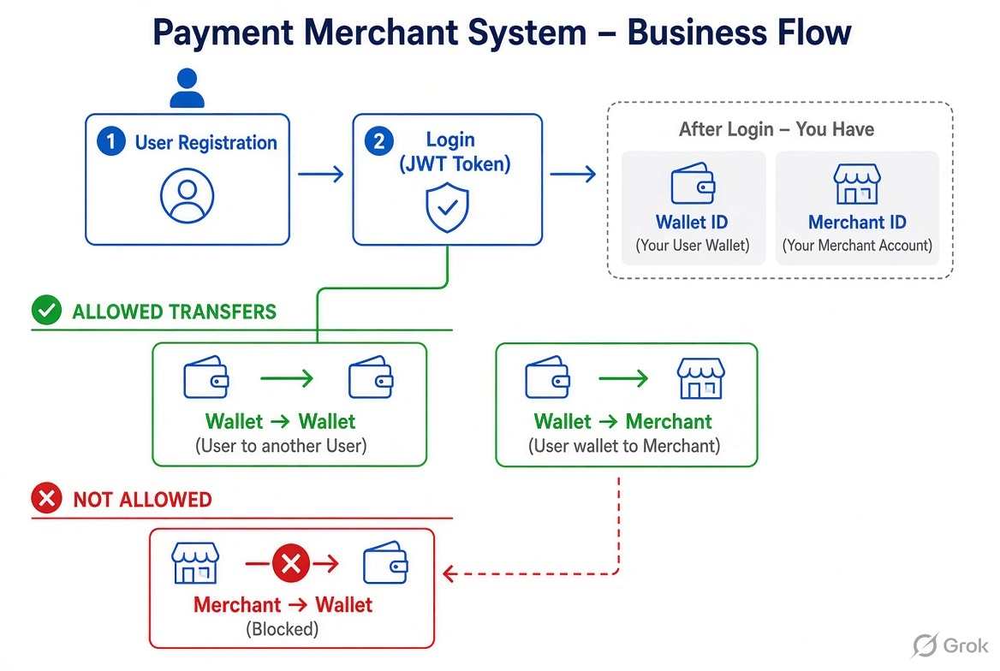
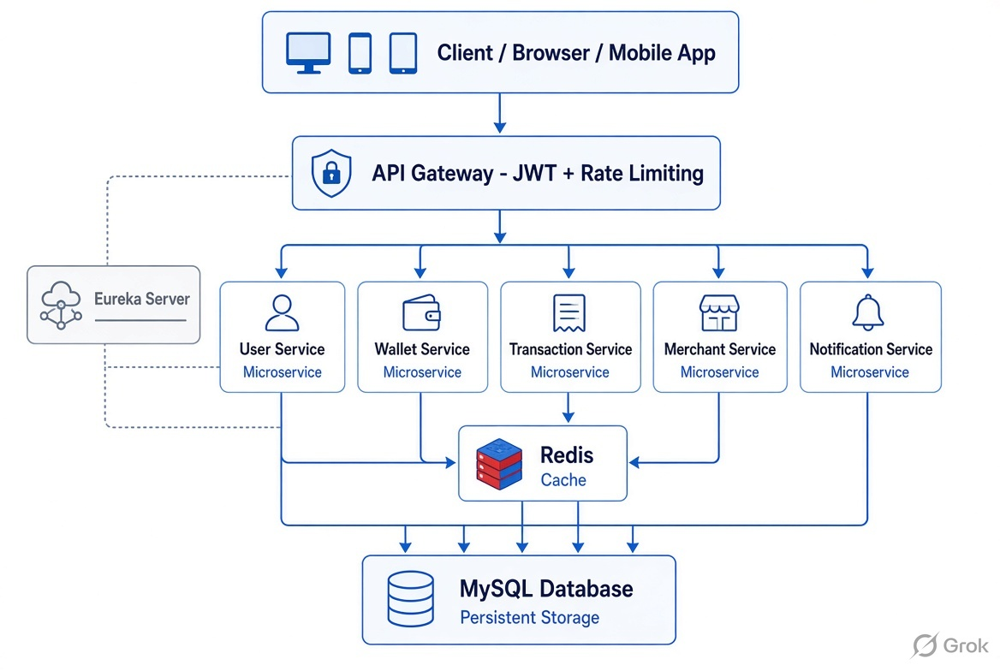

# Payment Gateway & Merchant Management System
A **distributed microservices-based Payment & Merchant Management System** built with Spring Boot 3.5 and Spring Cloud.  

It demonstrates production-grade patterns including Saga, distributed locking, centralized authentication, resilience, and containerized deployment.

**Live Demo** | [Eureka dashboard](http://localhost:8761) (after running)

## 📋 Project Overview

This system allows users to register, manage wallets, transfer money (P2P), and merchants to register and receive payments.  

All services are independently deployable, communicate via OpenFeign, and are secured through a centralized API Gateway.

## High level flow 



## ✨ Key Features

- **User Management** (Registration, Login, JWT)
- **Wallet Management** (Add Money, Balance Check)
- **Merchant Management** (Register)
- **P2P Money Transfer** with Saga Pattern
- **Pay to Merchant**
- **Distributed Locking** using Redis
- **Centralized Authentication** at API Gateway
- **Resilience Patterns** (Circuit Breaker + Retry + Fallback)
- **Rate Limiting** at Gateway level
- **Real-time Notifications** (via Notification Service)
- **Dockerized** deployment with Docker Compose
- **Eureka Service Discovery**
- **Swagger / OpenAPI documentation**

## 🛠 Tech Stack

| Layer             | Technology                                          |
|-------------------|-----------------------------------------------------|
| Framework         | Spring Boot 3.5.9                                   |
| Service Discovery | Eureka Server                                       |
| API Gateway       | Spring Cloud Gateway                                |
| Inter-service Call | OpenFeign                                           |
| Database          | MySQL                                               |
| Cache & Locking   | Redis                                               |
| Resilience        | Resilience4j (Circuit Breaker, Retry, Rate Limiter) |
| Security          | JWT (Centralized at Gateway)                        |
| Containerization  | Docker + Docker Compose                             |
| Build Tool        | Maven (Multi-module)                                |

## 🏗 Architecture



**Design Patterns Used**:
- Saga Pattern (Synchronous implementation with compensation)
- Circuit Breaker & Retry
- Centralized Authentication
- Distributed Locking

**Services:**
- **eureka-server** – Service Discovery
- **api-gateway** – Entry point, JWT validation, Rate Limiting
- **user-service** – User registration & authentication
- **wallet-service** – Wallet operations
- **transaction-service** – Money transfers (Saga)
- **merchant-service** – Merchant onboarding & management
- **notification-service** – Notifications

## Architectural Design Patterns Used

- Saga Pattern (synchronous with compensation)
- Distributed Locking (Redis)
- Centralized Authentication
- Circuit Breaker + Retry + Fallback

## 🚀 How to Run

### Using Docker Compose (Recommended)

```bash
# Clone the repo
git clone https://github.com/Mavishnu-KJ/payment-merchant-system.git
cd payment-merchant-system

# Build and run all services
mvn clean package -DskipTests
docker compose down
docker compose up --build eureka-server redis api-gateway user-service wallet-service merchant-service transaction-service notification-service
```
- Note : Using Local MySQL DB


## Access Points

- Eureka Dashboard: http://localhost:8761
- Swagger UI : 
    - user-service : http://localhost:8081/swagger-ui/index.html
    - wallet-service : http://localhost:8082/swagger-ui/index.html
    - merchant-service : http://localhost:8085/swagger-ui/index.html
    - transaction-service : http://localhost:8083/swagger-ui/index.html
    - notification-service : http://localhost:8084/swagger-ui/index.html

- API Gateway: http://localhost:8080
    - Can call service APIs via API gateway as well
    - Examples (via restclient or postman): 
        - http://localhost:8080/api/users/register
        - http://localhost:8080/api/users/login
        - http://localhost:8080/api/wallets/me/addMoney
        - http://localhost:8080/api/merchants/register
        - http://localhost:8080/api/transactions/me/transfer
        - http://localhost:8080/api/transactions/me/pay-merchant

## Access points

- Eureka Server - 8761
- API Gateway - 8080
- User Service - 8081
- Wallet Service - 8082
- Merchant Service - 8085
- Transaction Service - 8083
- Notification Service - 8084
- Redis - 6379
- MySQL - 3306 (Using local MySQL DB)

## 📌 Important Endpoints

- POST /api/users/register
- POST /api/users/login
- POST /api/wallets/me/add-money
- GET /api/wallets/me/balance
- POST /api/merchants/register
- POST /api/transactions/me/transfer
- POST /api/transactions/me/pay-merchant

## Project Structure

-   payment-merchant-system/
-   ├── api-gateway/
-   ├── eureka-server/
-   ├── user-service/
-   ├── wallet-service/
-   ├── merchant-service/
-   ├── transaction-service/
-   ├── notification-service/
-   ├── docker-compose.yml
-   ├── pom.xml                 (parent)
-   └── Info/                   (architecture diagram)

## 🧠 Key Learnings & Highlights

- => Implemented Saga Pattern for reliable P2P money transfers using synchronous Feign calls with compensation logic
- => Used Redis Distributed Locking to handle high concurrency during money transfers (P2P, Merchant)
- => Centralized JWT Authentication at API Gateway
- => Applied Resilience4j (Circuit Breaker, Retry, Rate Limiter)
- => Proper Docker multi-stage builds and profiles (dev & docker)
- => Clean separation of concerns using Feign Clients

## 📈 Future Enhancements

- => Distributed Tracing with Zipkin/OpenTelemetry
- => Spring Cloud Config Server
- => Database migration to PostgreSQL
- => Role-based access control (ADMIN role)
- => Event-driven notifications using Kafka